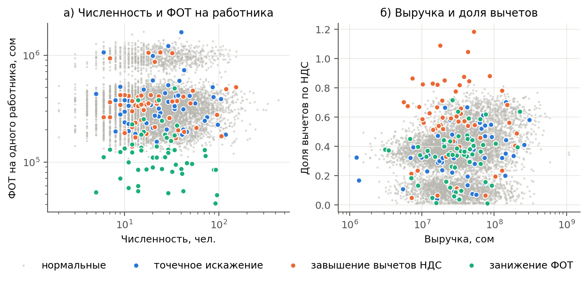
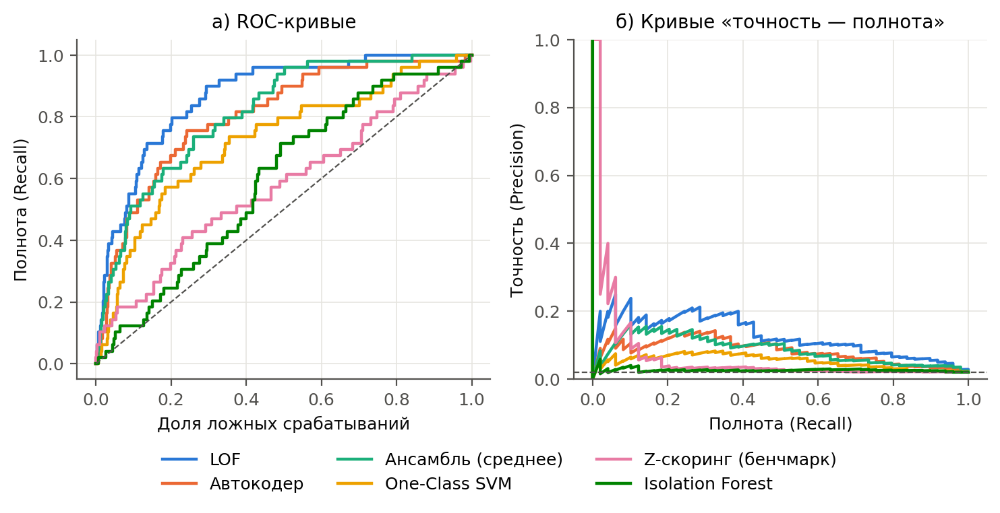
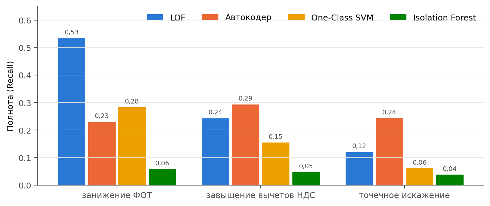
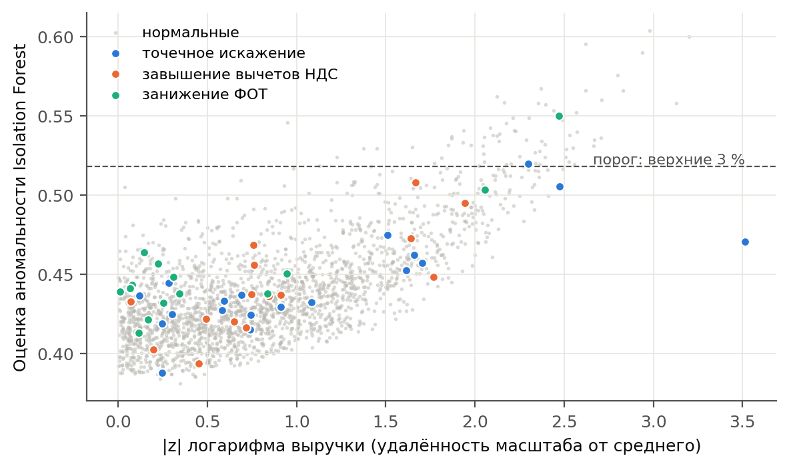

# Детекция аномалий в налоговых декларациях: сравнение методов без учителя

Код к статье «Применение методов машинного обучения для детекции аномалий в налоговых декларациях»
(Дубанаев З. М., научный руководитель Искаков Р. Т., КГТУ им. И. Раззакова). Статья готовится к публикации.

*Anomaly detection in tax declarations: a reproducible comparison of unsupervised methods (Isolation Forest,
LOF, One-Class SVM, autoencoder, ensemble) on synthetic data modelled on corporate tax declarations of the
Kyrgyz Republic.*

Пошаговое изложение всего исследования с пояснениями и рисунками — в ноутбуке
[`experiments.ipynb`](experiments.ipynb).

## Данные: синтетические

Реальные данные налогоплательщиков не используются. Генератор воспроизводит структуру полей Единой
налоговой декларации организаций КР (форма STI 101):

- для восьми отраслей заданы выработка на работника, доля расходов и материальных затрат, средняя
  зарплата и фондоёмкость; эти параметры — **экспертные предположения**, по реальным данным ГНС КР
  они **не калибровались**;
- налоги считаются по действующим ставкам (НДС 12 %, налог на прибыль 10 %);
- каждая декларация описывается 24 признаками: 21 числовой (выручка, расходы, ФОТ, численность,
  входной и исходящий НДС, доля вычетов и др.) и 3 категориальных (отрасль, регион, налоговый режим).

Три набора с разным профилем налогоплательщиков:

| Набор | Размер | Особенность |
|---|---|---|
| Декларации по НДС | 7 850 | плательщики НДС общего режима |
| Декларации по налогу на прибыль | 6 280 | тяжелохвостое распределение размера предприятий |
| Смешанный набор | 4 290 | общий режим, единый налог и патент |

В 2,1 % деклараций внедряются аномалии трёх типов, поровну:

| Тип | Что меняется | Что имитирует |
|---|---|---|
| точечное искажение | одна строка × 0,1–0,3 или × 3–8, зависимые строки не пересчитываются | ошибку заполнения |
| завышение вычетов НДС | входной НДС × 1,3–2, НДС к уплате пересчитан | фиктивные ЭСФ |
| занижение ФОТ | ФОТ × 0,2–0,5 при той же численности | зарплаты «в конвертах» |



## Как оцениваются модели, если они обучаются без меток

Модели **не видят меток**: на обучающей части (70 %) они изучают, как выглядят декларации, и выдают
каждой декларации оценку аномальности. Аномалии в обучающей части остаются — как и на практике.

Метки известны только потому, что аномалии внедрили мы сами. Они используются лишь в конце, чтобы
сравнить оценки моделей с истиной на тестовой части (30 %):

- декларация считается отмеченной, если её оценка входит в верхние 3 % → Precision, Recall, F1;
- ROC-AUC и PR-AUC оценивают ранжирование целиком, без порога (у случайного ранжирования
  PR-AUC ≈ 0,02, равен доле аномалий).

Каждый эксперимент повторяется 5 раз с разными начальными значениями генератора случайных чисел.

## Методы

| Группа | Метод | Принцип |
|---|---|---|
| статистический | Z-скоринг (бенчмарк) | z-оценки логарифма выручки и доли вычетов — аналог пороговых правил |
| изоляция (деревья) | Isolation Forest | случайные разбиения по одному признаку |
| плотность / близость | LOF | локальная плотность относительно соседей |
| граница области | One-Class SVM | граница области «нормальных» наблюдений |
| глубокое обучение | автокодер (d → 16 → 8 → 16 → d) | ошибка восстановления декларации |
| ансамбль | среднее | нормированные оценки четырёх ML-методов с равными весами |

## Результаты

Среднее по 5 запускам.

| Метод | НДС: F1 / ROC-AUC | Налог на прибыль: F1 / ROC-AUC | Смешанный: F1 / ROC-AUC |
|---|---|---|---|
| LOF | 0,270 / 0,867 | 0,305 / 0,876 | 0,164 / 0,832 |
| Автокодер | 0,259 / 0,864 | 0,243 / 0,859 | 0,145 / 0,842 |
| Ансамбль (среднее) | 0,223 / 0,830 | 0,256 / 0,851 | 0,139 / 0,814 |
| One-Class SVM | 0,136 / 0,727 | 0,161 / 0,750 | 0,109 / 0,738 |
| Z-скоринг (бенчмарк) | 0,116 / 0,583 | 0,111 / 0,608 | 0,139 / 0,607 |
| Isolation Forest | 0,043 / 0,596 | 0,041 / 0,613 | 0,024 / 0,617 |



Методы находят разные типы аномалий: LOF лучше выявляет занижение ФОТ, автокодер — завышение вычетов
и точечные искажения.



Isolation Forest близок к случайному ранжированию: его оценка растёт вместе с удалённостью размера
предприятия от среднего, и 97–98 % отмеченных им деклараций — нормальные крупные и мелкие предприятия.



Ансамбль с равными весами не превзошёл лучшие одиночные методы.

## Запуск

Нужен Python 3.9 или новее.

```bash
python3 -m venv venv
source venv/bin/activate          # Windows: venv\Scripts\activate
pip install -r requirements.txt
python experiments.py             # все эксперименты, анализ и рисунки
```

Полный прогон занимает несколько минут; таблицы печатаются в терминал, сырые результаты сохраняются в
`results_raw.csv`, рисунки — в `figures/`. Все случайные значения фиксированы, поэтому результаты
воспроизводятся точно. Для пошагового разбора: `pip install notebook` и `jupyter notebook experiments.ipynb`.

## Файлы

| Файл | Содержание |
|---|---|
| `experiments.ipynb` | пошаговое изложение исследования с пояснениями и рисунками |
| `experiments.py` | генератор данных, методы, эксперименты, анализ и рисунки |
| `results_raw.csv` | результаты каждого запуска |
| `figures/` | рисунки к статье |
| `requirements.txt` | версии библиотек |

## Ограничения

Результаты предварительные: данные и аномалии синтетические, параметры генератора — экспертные
предположения, гиперпараметры не подбирались, порог фиксирован. Для практических выводов нужна
проверка на реальных обезличенных данных.
